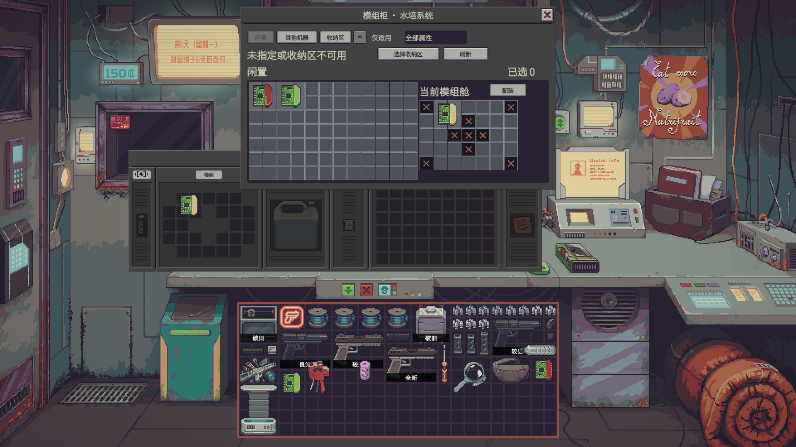
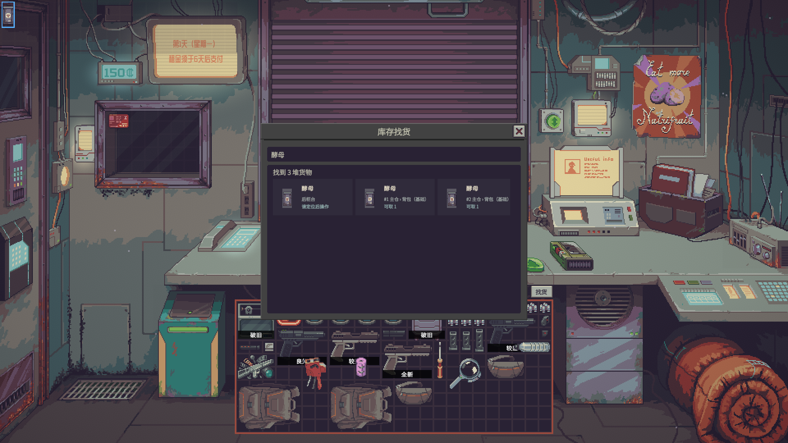

# 更好的体验功能与用法

更好的体验提供 41 个可按需配置的主功能开关。按操作影响分为一级信息与手动辅助（20 项）、二级规则与批量执行（15 项）、三级跨库存与机器管理、方案规划（6 项）；游戏内先按等级进入，再按物品与仓储、交易与委托、机器与生产、日历与工作台、快速播放分组查找。功能号用于查找设置，不是快捷键。安装与可复现命令见 [README](README.md)，游戏机制与适配边界见 [技术说明](Probably%20Stolen%20体验MOD技术实现方案.md)。

首次使用或重置设置时，仅 F02、F03、F04、F05、F38、F39、F40、F41 八项一级主功能默认开启，二、三级主功能全部默认关闭。批发留柜是独立的二级开关，自动腾位为二级子选项，额外读取隐藏风险为三级子选项，均默认关闭；已有保存的选择继续保留。

## 入口与设置

在 Steam 创意工坊订阅并等待下载完成，在游戏主菜单 **Mods → 更好的体验 / Quality of Probably Stolen** 启用，按游戏提示重启。手动安装可将完整的 `ShopAssist` 文件夹放入游戏目录的 `Mods`；同一模组 ID 的本地副本会覆盖工坊副本。选项和 Mods 齿轮设置按三级组织，每级内再按用途分组；修改后点击 **应用**。归仓规则、执行和预览相邻排列，配装与模组柜相邻排列；跨级子选项归入对应等级。

同一功能的主开关加粗，相关参数缩进排列；位置、样式等选项直接按文字选择。悬停设置旁的信息图标查看触发方式、效果和条件。**查找功能与设置** 支持功能编号、名称及用途描述，并区分功能开关、附加选项、数值和快捷键。点击结果跳到实际设置；离开有未应用修改的设置时，可继续编辑或确认放弃。

已开启功能的操作位于对象附近：仓库及物品右键、机器窗口、顾客议价面板、鉴定工具、电脑和拾荒窗口。主仓旁提供 **找货**、**机器状态** 和有事项时出现的 **待处理**；有最近操作结果时可直接查看明细。设置页提供开关、外观、默认行为与快捷键。

批量操作结束后显示完成数量和未处理原因，详情可从待处理中查看。同一次操作的重复通知合并，不同操作即使文案相同也各自保留；错误和待处理提示优先显示。待处理列出对象、位置和原因，提供可执行的定位、重试或确认已处理入口；机器总览关闭时仍可访问。需要检查的搬运结果和待补种状态随当前存档保存。

全局开关和外观设置由本机共享；待办、仓储规则、预留、模组收纳位置、维护来源与账本跟随当前经营存档。F02 默认居中、14 号字、无黑底。F38–F41 提供显示和手动操作增强；跨库存与后台自动化需开启各自功能。

## 卷帘门与待办

关门时，日历、待办和期限显示在门上居中的信息区域，四周保留门体。日历使用原版两周日期与公开事件；悬停看全文，点击日期在门内看详情。待办可直接勾选，使用旁边的添加入口管理文字、重复方式和已完成项目。长列表在门内切换查看。

顾客计数屏上方机壳显示未完成数。关门时点击它聚焦门上的待办；营业时点击展开机件旁便签。门升降时暂停门面点击，内容跟随移动并裁切。房租、按揭和已跟踪委托的到期事项统一放在门底。日历与期限仅显示原版数据。

## 物品操作

**整理当前容器：** 右键网格空白或其中的物品，选择智能整理；有框选时整理选中物品，否则整理全部。用原版右键菜单固定不想移动的物品，整理时会绕开它们；固定状态随存档保留，也会限制普通移动。菜单默认在鼠标移出后保留，点击外部、按 Esc 或执行后关闭，可关闭此子选项恢复原版退出方式。没有合法摆放时保持原状并提示；库存未发生后续变化时可撤销最近一次整理。

**自动腾位：** 在 F05 中单独开启，默认关闭。普通网格拖放本来可以放下时沿用原版；空间被零散占用时才尝试重排。整次拖放和辅助搬动共同撤销；精确组拖、拆堆合堆、特殊槽位及无法完整恢复的操作不触发腾位。

**整组搬动：** 在同一物品网格框选后拖起，按游戏原有旋转键旋转整组。移到目标容器时查看整个编队的落点；碰撞或越界处显示不可放。按当前落点精确放下，空间不足时继续拖动调整或取消。固定、锁定、特殊槽位和工作中的设备仍遵循原版规则。

**模组柜：** 打开机器，在模组舱附近点击 **模组柜**。闲置模组按真实形状排列，包含可访问的主仓、柜台、展示柜和普通容器中的自有模组；当前机器的模组舱紧靠右上角，其下方继续排列库存。物品少时窗口收窄，物品多时扩大并分页；可搜索、分类及直接拖放。**其他机器** 和 **收纳区** 页展示对应的真实格子。拆下模组前指定真实收纳区，拖回闲置页时默认送入该区；切到 **收纳区** 可精确放到指定格。空间不足或不能拆卸会在格子上提示。可单击或框选最多 5 件闲置模组作为配装候选，也可只调整已装件；点击 **配装** 后比较布局和属性变化，再应用。已有、固定和卡住的模组会保留，不同来源的候选不会被当作一个真实物品编队拖走。

**找货：** 在主仓旁打开找货，按名称搜索可访问的自有库存，包括未打开的普通容器；锁住、隐藏和特殊区域不参与搜索。点击结果可定位；符合安全条件的整堆物品可拖入已打开库存的空位或拖到可容纳整堆的同类物品。交易台及部分机器槽位需要定位后用原版操作放入。搜索不会自动搬货。从议价面板进入时直接查看顾客需要的货物及报价，定位后可返回列表；交易仍由玩家操作。

**选来源或目标：** 换电池、换滤芯、补料、备货、卸货等使用物品和容器卡片。点击来源或目标卡，选择实际盒子或仓页，再保存。重命名不改变已保存的对象绑定。保存自动规则本身不立即消费物品。

**批量搬运：** 归仓、卸货和拾荒装包只在状态相容且目标能容纳整堆时合并，否则尝试将整堆放进空位。结果无法确认时先在待处理中核对。

## 检测与物品标记

检测结果留在原仪器内：上方显示样本与总量，检测结果和标签并排，下方按成分、体积、占比排列。左侧星标可置顶多个成分，点击成分在仪器旁打开处理方法；齿轮内可调整排序和显示。数值原位更新，悬停时暂停重排；同一样本中置顶成分耗尽保留零值，换样本后不保留旧样本数据。原版检测、对质、标签匹配和化学操作仍使用原来的入口。

方法卡区分普通滤芯、UV、净水片、净水机和蒸发器，显示当前机制允许的方法、处理能力、残留与消耗。净水片需要容器实际运行氯反应；并非所有能装液体的容器都具备这一回调。过滤与蒸馏也不保证所有污染物归零。

原版公开贴出的“赝品”“实验室纯级”等标签显示在物品上；自定义提示中的标签须先实际查看过；小物品或多个标签显示紧凑摘要，悬停看全文。赃物标记只使用已揭示或已识别的信息，容器本体与容器内含赃物的标记不同。角落、大小和样式可设置；名称、标签和计数优先避让；空间有限时以紧凑摘要显示。

## 逐项功能

### 物品与仓储

**F02 把储藏区名称显示在格子中央**

已命名的储藏区和机器区直接显示名称，默认居中、较大字号和轻微描边。可调整字号与位置；名称显示不会拦住鼠标。

**F05 右键一键整理当前容器**

右键物品或网格空白，选择智能整理；已有框选时整理选中物品，否则整理全部。原版固定物品和委托预留物品不会被整理移动。可撤销最近一次仍有效的操作。鼠标移出后保持菜单默认开启，自动腾位默认关闭。

**F07 设置每个储藏区收什么**

在主仓及其内部储藏区设置要接收的品类或具体物品、排除项和优先级。具体物品规则优先于品类规则；可指定目标不可用时是否尝试其他区域，同一容器的不同页可分别设置。

**F08 把框选物品放回指定储藏区**

从主仓及其内部储藏区，或已确认完成交易的后柜货物中框选物品，再按规则归仓。已在优先匹配目标中的货物保持原位；放不下、固定或已预留的物品留在原处，并显示原因。

**F09 归仓前查看物品和去向**

执行归仓前显示所选物品以及它们要进入的真实储藏区。可检查目标和无法移动的原因，再确认或返回。

**F20 悬停容器查看里面的物品**

在店内把鼠标停在可查看的普通容器上时显示内容，减少反复开关窗口。锁住、隐藏或必须实际开封的内容继续按原版操作。

**F22 用标签机给同类物品批量贴标**

先用原版标签机处理一件样品，再在图形网格中跨页点选、全选或清空同类物品。通过快捷键或右键样品打开时，会预选符合条件的框选物品；右键其他同类物品打开时预选该物品。其他符合条件的可见物品仍可选择。蓝色标签机复制名称，普通标签机复用当前特征标签；覆盖已有标签需开启对应选项。中断时可查看已完成、跳过和未处理的项目。

**F25 回店后只卸下本次带回的物品**

外出前记录随身物品，返回后选择本次确定带回的货和目标容器。来源不明或与旧物混合的货物显示为待核对，可定位后手动处理；原本带出的工具不会被自动卸下。

**F26 把选定的液体倒入同一个容器**

右键水容器选择目标，再点选水质已知的来源。可使用安全状态下的空酒瓶或已检测水质的酒瓶；显示容量和流入流出结果，滤芯耗尽会暂停后续来源，可换芯重新预览，或明确选择继续倾倒未过滤的水。

**F36 把选中的拾荒物品装进背包**

在已出现的拾荒物品网格中选择要带走的东西，可设优先物、背包保留空格和排除品类。价值模式标出估价未知而未参与的物品；预览说明留下的原因。部分失败时显示未处理物品；不能确认恢复的物品停止自动搬运，并在返店后的待处理中保留检查记录。

**F38 显示物品已经贴出的标签**

在物品图案旁显示当前公开可见的标签，例如赝品或实验室纯级。多个标签紧凑排列，悬停可查看全文；仅显示玩家能看到的标签内容。

**F39 给已知赃物加常驻标记**

对原版已揭示或玩家已识别的赃物显示固定角标，默认在左上角。可调整位置、大小和样式；容器本体与里面有已知赃物使用不同提示。

**F40 框选后整组旋转**

在店内自有普通库存的同一网格里框选多件物品并拖起，按游戏已有的旋转键或滚轮旋转整个编队。允许从物品上开始框选的选项默认开启；按住游戏框选键和 Alt 即可从已有物品格开始。关闭 F41 后，跨容器放下仍由原版自动安排位置；按住原版 Shift 键可保持编队精确放置。

**F41 把框选物品精确放入容器**

拖动同一网格内框选的物品时，保留它们的相对摆放。绿色落点可整组放下，红色表示碰撞或越界；可调整位置或按取消键返回。

### 交易与委托

**F01 买下的货物留在后柜台**

成交后，已付款的货物继续留在后柜台，方便当场检查、贴标或归仓。普通购买与批发可分别设置，原版自动入库开关仍由玩家控制；彩票、易货和店外购买沿用原版。

**F03 高亮符合当前顾客需求的物品**

按原版实际收购规则标记货物，包含具体物品、类别、特殊需求、拒收及以物易物。普通、赃物、违禁品使用不同颜色；外层容器提示内部匹配物品，机器工作槽和可出售产出分开处理。全收商人默认不显示需求高亮，可单独调整；常驻赃物标记不受此选项影响。

**F04 搜查时标出已知赃物**

遇到搜查时标记已知风险物品；曾见过赃物的容器会有不同提示，打开后继续指向具体物品。未知箱内风险是单独的增强选项。

**F11 跨库存找货**

在主仓旁或使用绑定的快捷键按名称搜索可访问的自有库存；从议价面板打开时显示顾客需求、来源、状态和预计售价。点击结果可定位；可安全转移的整堆物品可拖到已打开库存的空位或可容纳整堆的同类物品，部分机器槽位需要定位后手动处理。子选项“显示购入价对比”默认关闭；缺少记录显示未知，不推算拆合堆后的单位成本。可定位后返回原列表。

**F16 成交后显示金额和声望变化**

完成一笔交易后，在顾客附近轻微浮动显示金额和阵营色声望并淡出。同笔交易合并，连续同金额交易分别显示；提示音与显示同步。可以分别设置显示项目、停留时间和提示音。

**F23 在鉴定时计算估价**

在鉴定工具旁打开估价表，录入观察结果和各项金额。合计完成后可填回原版估价输入框，方便核对与提交。

**F24 把鉴定回单放进指定容器**

右键一个可用容器设为回单盒，或从图形选择器选择。之后新生成的鉴定回单会放到那里，目标不可用时走原版投递。

**F27 跟踪市场委托并预留交货物品**

在市场委托旁点击跟踪，查看剩余期限并选择要留给它的实物。预留可逐件解除，更换备货箱不会释放或自动搬运原货物。窗口分别显示预留数量、其中已在目标容器的数量和待迁移货物；预览确认后搬运，部分完成后可重试剩余货物。备货与原版正式交付分别操作。预留记录无法读取时，可在待处理中核对货物并确认重新开始。

**F28 按天查看收入和支出**

查看启用后观察到的每日收支，按交易类型筛选，并核对当前现金。可逐日切换或输入日期；本次存档会话会记住上次查看日期。售出物有已知进价时显示对应利润，未知成本单独标明。

**F29 从指定库存补充展示柜货物**

点选要展示的实物及其来源，设置目标数量和来源要保留的数量。预览显示每堆取出数量、来源剩余和未补足原因；需要部分数量时使用原版拆堆流程。例如库存 10 件、展示柜缺 4 件且来源需保留 2 件，可取出 4 件并留下 6 件。价格和标签处理与原版手动拆分一致。

**F34 按顾客报价和预算选一组货**

从顾客货物网格按预计售价与预算比较可交易的组合，无需先把货物搬上交易台。原版议价面板未显示预算时自行输入上限；自动摆货需另行开启，并要求议价面板打开、台面无组合外货物且有足够空间。

### 机器与生产

**F10 从模组柜直接装卸机器模组**

打开机器后点击模组柜，用物品图形查看全店闲置模组和其他机器中的模组，可直接拖入机器。拆下前需将主仓或其内部可插入的普通容器、储藏页指定为模组收纳区。

**F12 按性能、效率或品质安排模组**

在模组柜可选择最多 5 件闲置模组，也可只调整已装件；两者合计最多 12 件。选择主要提升的属性后查看建议摆法和属性变化，确认后保留已装件并放入新件。蒸发器只填空格。

**F19 清晰显示检测结果和处理方法**

在原检测仪内分区显示样本、总量、检测与标签对照及成分列表。支持占比排序、多个成分置顶和字号设置。点击成分查看滤芯、UV、药片或机器的处理卡，展开后查看能力和残留限制。

**F30 查看机器缺料缺电和待取成品**

用机器图形总览查看已适配设备的原料、电力和产出状态，可只看需要处理的机器。选中卡片显示完整位置；设备所在库存窗口已打开时，可将该窗口置前。

**F31 机器电量低时自动换电池**

在水培机或打印机旁选择备件容器和电量阈值，来源可选主仓，也可先保存空来源；备件可按容器位置或最高电量选择。界面显示匹配数量和当前交换状态；可把静态配置复制给尚未设置规则的机器。夜间机器具备生产条件且电量不足时换电，旧电池要有合法返回位置。

**F32 水培收获后补种指定种子**

从这台水培机输入或产出中的种子选择品种；同种植物有多个品系时需打开植物扫描仪。非多年生作物完成收获后，从本机产出取一粒匹配种子补种。暂缺种子或需要拆堆时保留等待状态，相关库存变化后重试，也可从待处理手动重试；玩家自行放种会结束等待，关闭功能则暂停。移动结果不确定时要求检查。

**F33 让熔炉按指定批数补料和收货**

在熔炉旁选原料、来源、成品容器和批数。确认后只在上一批真正生产完成后继续下一批；缺料、缺电、空间不足、输入或输出未清空，或存在冲突模组、输送器时暂停。投料或产出无法确认时先核对；安全完成后可沿用设置再开一批。

**F35 滤芯耗尽后从指定容器补换**

在净水壶或养殖系统旁选择备件来源和允许的材料，来源可选主仓。已勾选种类的在用滤芯在处理时耗尽才触发更换；新规则默认三类全选且只换同款，也可明确允许其他已勾选材料按孔径替代。界面显示匹配数量和当前交换状态，配置可复制给尚无规则的设备。

**F37 酿酒后把活性酵母送回原位**

从容器或储藏页把活性酵母放进酒瓶后，记录它原来的位置和方向。开始酿造时优先送回原格；原格被占时在主仓、前后柜台及展示柜寻找安全位置。都放不下时可返回腾位，或按原版继续发酵并可能损失酵母。

### 日历与工作台

**F13 收起窗口和恢复工作台**

一键收起已打开且可操作的物品窗口；使用原版储藏协调器保存和恢复常用窗口组合，快速回到自己的工作台布局。

**F14 调整议价面板的位置和关闭方式**

把议价面板放到顺手的位置，调整关闭按钮和停靠方式。需要重新布局时可直接从当前面板旁恢复位置。

**F15 在卷帘门上显示两周日历**

卷帘门落下时，直接在门上显示本周和下周的日期及公开事件。点日期查看当天详情；卷帘升起时，内容跟随门收起。

**F17 在卷帘门上显示可勾选待办**

点击顾客计数屏上方的机壳记录事项，每条周期可选一次性、每日、白天或夜间。未完成事项排在前面；可确认后批量清理已完成的一次性事项。关门时待办逐条显示在门上并可直接勾选；营业时从机壳打开便签。数据无法读取时，可重试，或核对事项后确认重新开始。

**F18 调整鉴定图像的大小和位置**

在原版鉴定工具中调整镜框、图像和托盘的显示，方便比较细节。可从鉴定工具旁恢复默认视图。

**F21 在卷帘门上显示到期事项**

卷帘门底部集中显示房租、按揭和已跟踪委托的剩余时间。提前提醒天数决定何时高亮临期事项，方便安排当天工作。

### 快速播放

**F42 快速播放**

设置快捷键后，按住或按一下切换快进，可选 2、4、8、16 倍。加速对话、卷帘、角色进退场、电话接通、转场和已适配的剧情展示；遇到选项、确认或文字输入时暂时恢复原速，手动操作完成后继续。右上角显示快进或暂停状态。读档、返回主菜单、失焦、切换操作模式或关闭功能时结束快进。

日期、生产、战斗判定、业务复核和实际加载保存保持原有规则；手动确认结束一天仍只结算一次。快捷键默认未绑定，功能默认关闭；设置中可查看绑定状态并跳转到原生按键设置。

## 支持范围

自动换电池面向已适配的水培机、打印机；水培补种使用本机产出的单份种子及已选品系；批次补料面向熔炉。滤芯维护覆盖已核验的净水壶和 RAS 循环水养殖机过滤槽，具体可选来源以对应机器界面为准。未适配或存在未知回调的特殊对象不强行转移。

所有自动动作遵守物品归属、固定、工作锁与委托预留。目标失效、空间不足或用户在操作中改变物品时，停止并保留实际结果，不重复执行已完成项。切档重新读取当前档的规则；停用只停止新动作，不逆转已经完成的交易或搬运。

制作接口参考：[游戏开发者 MOD 文档](https://github.com/dragonpan2/probably-stolen-modding)。
