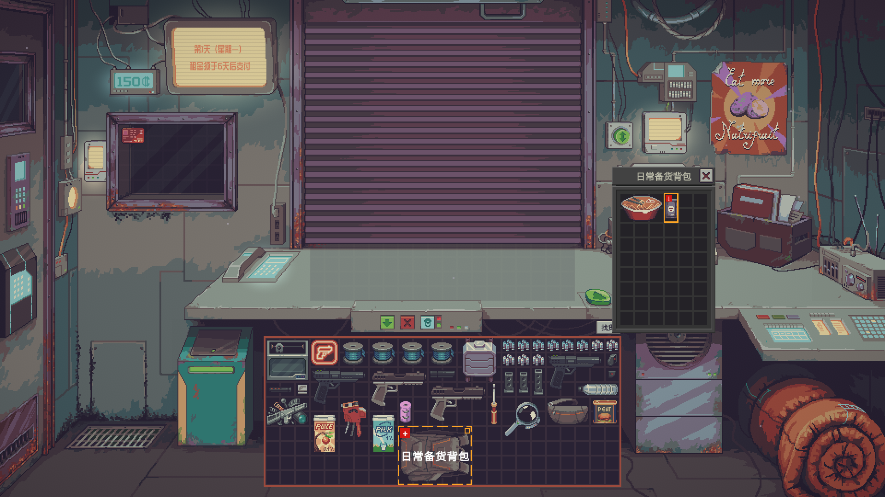
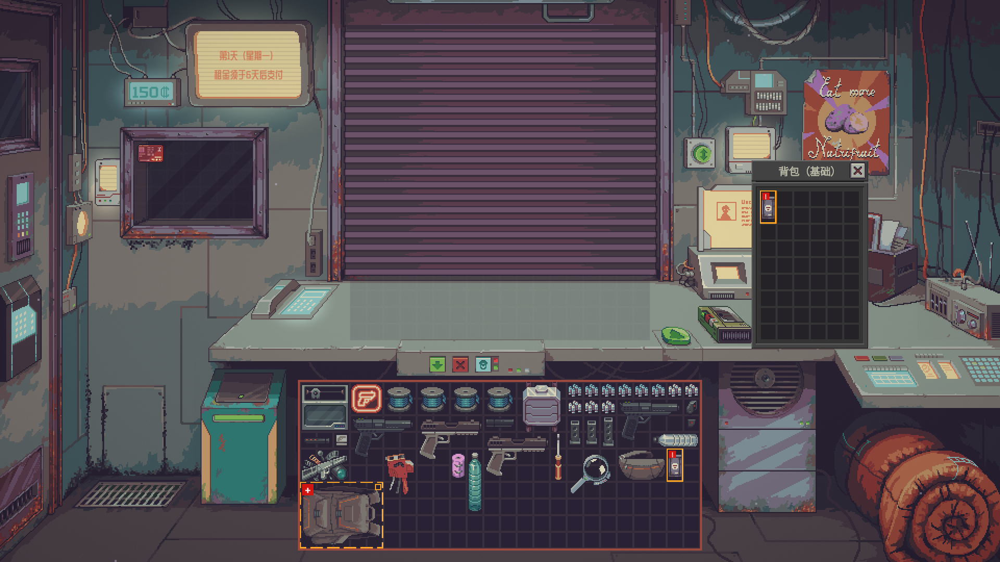
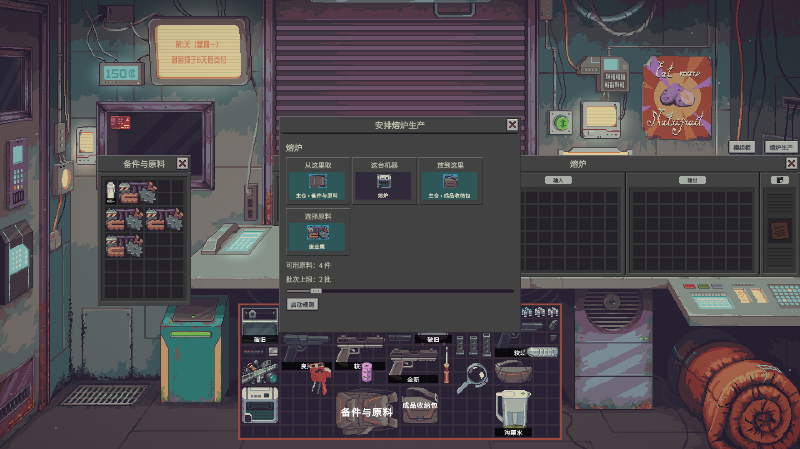

# Quality of Probably Stolen | 更好的体验

Quality of Probably Stolen currently has **36 primary features**: 19 in Tier 1, 11 in Tier 2 and 6 in Tier 3. Fresh settings enable F02, F03, F04, F05, F38, F39, F40 and F41. Other primary features start off; existing choices are kept. F numbers identify settings and are not shortcuts.

## Install and configure

Subscribe on Steam Workshop, wait for the download, then enable **更好的体验 / Quality of Probably Stolen** under Mods and restart when asked. For manual installation, put the complete `ShopAssist` folder from the ZIP in the game's `Mods` folder, with `manifest.xml` and `ShopAssist.dll` together.

Settings are shown as **tier → purpose group → feature → subsettings**. Select **Apply** after editing. The feature finder searches by F number, name and purpose. Actions appear beside native context menus, storage headers, machines, the trade window, the appraisal view and the scavenging scene.

Automatic transfers reuse native pin, lock, ownership, work-lock and receiving rules. Operations stop when they cannot be verified; results that need inspection remain in Attention.

## Tier 1: information and manual controls

### F02 Show container and machine names
Show custom storage and machine names on item art or window headers. Text does not block input; position, size and background are configurable.

### F03 Highlight goods the customer wants
After a customer arrives, use the native buying predicate to highlight matching goods. Ordinary demand, stolen goods and contraband use different markers; containers can show a matching item inside.

### F04 Highlight known risks during inspections
Mark known stolen goods, contraband and containers where the risk was observed. Extra hidden-risk reading is a separate Tier 3 option and starts off.

### F05 Smart Arrange from the native context menu
Right-click a grid or an item. There is one Smart Arrange action: it uses the current selection when present, otherwise the current grid. Native pins remain untouched. Grid menus use native undo; item menus expose undo whenever a valid undo exists, including a full grid. Making room when a dragged item does not fit is a separate Tier 2 option and starts off.

### F14 Move and dock the bargain panel
Dock the bargain panel on either side of the trade window or drag its header to save a position. The left dock mirrors the panel artwork so it remains symmetric with the right dock. The close control uses the native close icon inside the panel. Trade-header actions use native button styling.

### F15 Eight-day shutter calendar
The shutter shows yesterday, today and the next six days: eight positions total, with today second. The day before day one shows its weekday without event details. Events and details come from the native public calendar.

### F16 Trade receipts
Show cash and reputation changes near the customer. Cash, reputation, duration and sound can be configured; native settlement remains unchanged.

### F17 Shutter checklist
Add a preset or type a task yourself. Choose one-time, daily, daytime or nighttime repetition, and a target count from 1 to 10. Unfinished tasks appear on the shutter and update as counts are completed.

### F18 Adjust the appraisal lens
Adjust image scale, frame opacity and tray opacity, with a default-off option to hide the magnifying-glass frame. Changes apply to the native appraisal view and are restored on close or reset.

### F19 Scan results and treatment methods
Show composition and ratios in the native scanner, with verified treatment methods in a separate detail window. Native device callbacks are preserved.

### F20 Preview container contents on hover
Hover an allowed ordinary container to preview its contents. Locked, hidden and open-required containers keep the native workflow.

### F21 Shutter deadlines
Show rent or mortgage deadlines. Highlighting can start 0–3 days early.

### F23 Embedded appraisal worksheet
The worksheet appears with the native appraisal view. Verified item types use dropdown choices and start as **Unconfirmed**. You can undo, fill the native estimate field and open the matching native appraisal manual. Fuel's public manual conflicts with the current game's calculation constants, so automatic fuel totals are unavailable.

### F28 Daily cash flow
Open the ledger beside the computer to review income, expenses, cash changes and known-cost margin by day and transaction type. Missing purchase costs are counted separately; no cost is invented after splitting or merging.

### F38 Show public item labels
Show labels already visible in the native tooltip and reveal their full text on hover. Hidden labels are never read.

### F39 Mark known stolen goods
Add a persistent marker to stolen goods already revealed by the game or observed by the player. Containers and risky contents use different shapes.

### F40 Rotate selected items as a group
After selecting items in one grid, use the game's current rotate-key, right-click and wheel semantics to rotate the group. No separate rotation scheme is introduced; pins, locks and unknown callbacks keep native rejection behavior.

### F41 Place selected items precisely
Keep relative positions and irregular masks for a selected group. Preview and commit use the same collision and boundary checks.

### F42 Fast playback
Speed up verified dialogue, character paths, calls and presentation scenes. Choices, confirmations, input, loading and saving return to normal speed; unknown callbacks fall back to normal speed.

## Tier 2: rules and batch actions

### F01 Keep normal purchases on the back counter
Normal purchases are intercepted only for the matching `BuyItem` call. Wholesale has its own switch and space check. Barter, lottery, outside purchases and the native auto-store option keep their native behavior.

### F07 Set storage receiving rules
Use the left side of a storage window header to choose public categories, then configure receiving and automatic shipping independently. Categories come from the public game list; multiple matching areas use stable area ordering.

### F08 Route goods by category rules
Right-click a grid with a selection to process that selection, or process the current grid when there is no selection. This is separate from Smart Arrange and never moves pinned goods. Matching areas are tried by category match and stable area key; a source stack can fill compatible stacks in multiple areas. The remaining stack goes into an empty slot or stays in place when it cannot be moved safely.

### F09 Preview routing
Review each item, destination, stack or empty-slot result and skip reason. A rule or inventory change invalidates confirmation.

### F24 Appraisal receipt destination
There is no separate destination window. Choose front counter, trash bin, showcase or main stock in settings; unavailable targets keep the native fallback.

### F25 Return unload mode
One setting controls the modes: Off, Unload all or Unload new only. On return, goods with a confirmed source and destination are processed automatically. Old goods, merged stacks, lack of space or unreadable rules remain in Attention; no ordinary unload window opens.

### F31 Automatically replace low batteries
For verified battery devices, select a source container and one condition: keep the best energy, keep the best percentage or replace only when unable to run. Shared sources serve devices with less than two runs of energy first, then sort by current energy; ties are randomized. Special power paths and unknown slots fall back safely.

### F32 Automatically replant a chosen seed
Choose a seed type and source container. The source list shows only containers with usable seeds and marks them with a number and name. Type, quantity, receiving permission and the native planting callback are checked again before moving.

### F33 Supply and collect furnace batches
Configure input source, output destination and batch count. Missing material, space, machine state or unknown callbacks pause the action and retain recovery information.

### F35 Automatically replace pitcher and aquaculture filters
Choose a source, material and condition: replace when exhausted or keep the best remaining durability. Only containers with usable filters appear and are numbered; the old filter must have a verified safe return path.

### F37 Return live yeast after brewing
Remember the real position and orientation before brewing, then return the yeast to that position when possible. A verified fallback location is used only when the original is unavailable.

## Tier 3: cross-inventory and machine management

### F10 Module cabinet
Filter idle modules, other machines and storage areas by attributes such as efficiency and performance, with descending sort. Sources and storage areas remain real inventory grids.

### F11 Cross-inventory stock search
Search accessible owned inventory by name and show source, quantity, pin or in-use status, and optional recorded purchase price. Search and locate do not move goods; only safe full-stack transfers can be dragged.

### F12 Module layout preview
Preview a module layout by verified attributes without changing real modules until confirmation. Unknown machine callbacks remain informational only.

### F30 Machine supplies, power and output
Use a larger machine overview for missing input, missing power and pending output. Double-clicking a card opens the corresponding machine window.

### F34 Choose customer goods by quote
Open it from the trade-window header. The preview uses the real counter grid and reserves space for refused goods without counting them in the price. Filters can exclude stolen, contraband or luxury goods, or require only public demand tags. Placement uses the native counter callback and stops when callbacks cannot be verified or price or space changes.

### F36 Automatic best-value scavenging plan
Scavenging has one planning action. It values publicly visible goods, compares bounded backpack-and-hands plans and reports the result as approximate. Replacing carried goods is off by default and only occurs when the old item can be safely returned and the new item can be safely inserted. A nonempty backpack can be planned as a whole when its contents are visible and can be verified safely. Native placement limits apply, and the equipped backpack is not swapped automatically. Interrupted replacements attempt to restore the items; uncertain results stay in Attention, with a warning before leaving if an item cannot be recovered.

## Images and validation

Images live in `docs/images`. Isolated validation uses a separate test identity and save and never reads or changes a player's save.

Please use the project issue tracker for feedback. Thanks to the game author, the modding community and everyone who reports problems.
