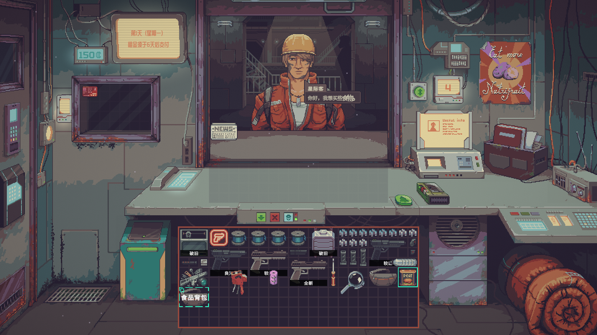
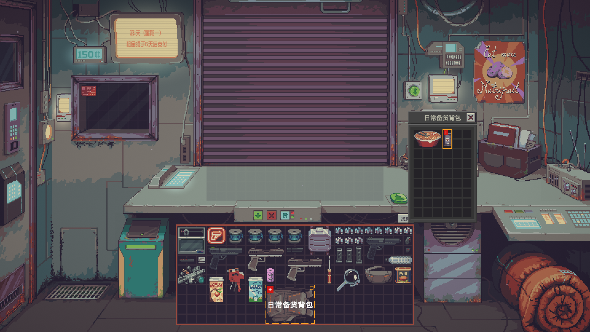
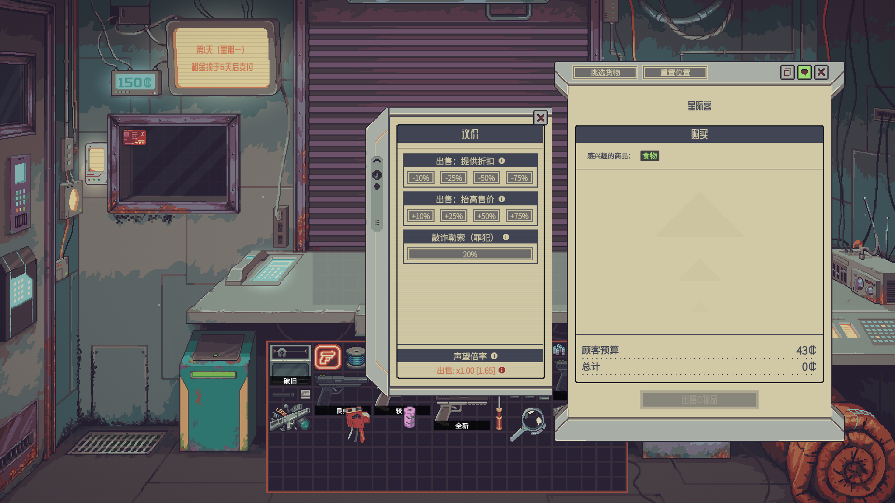
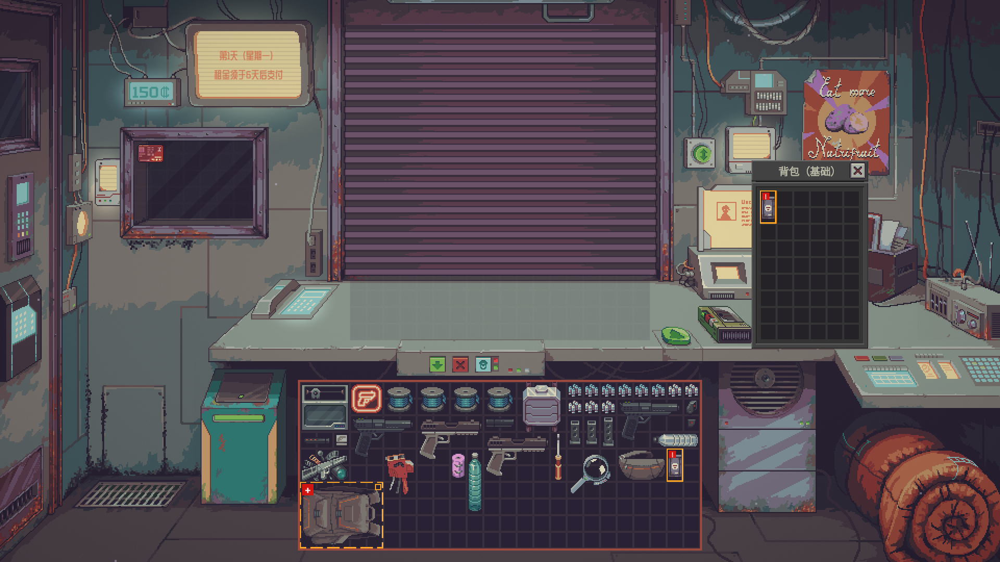
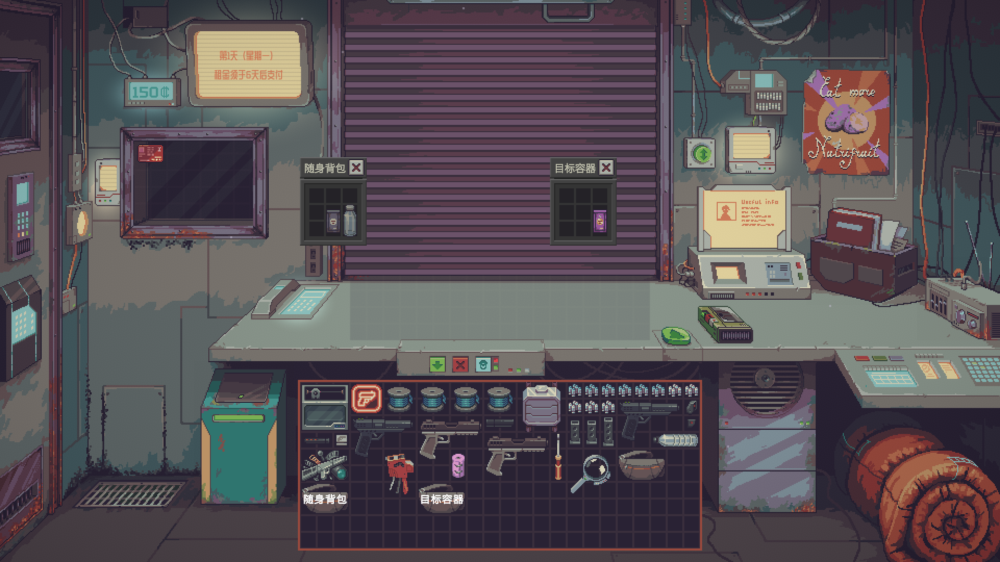
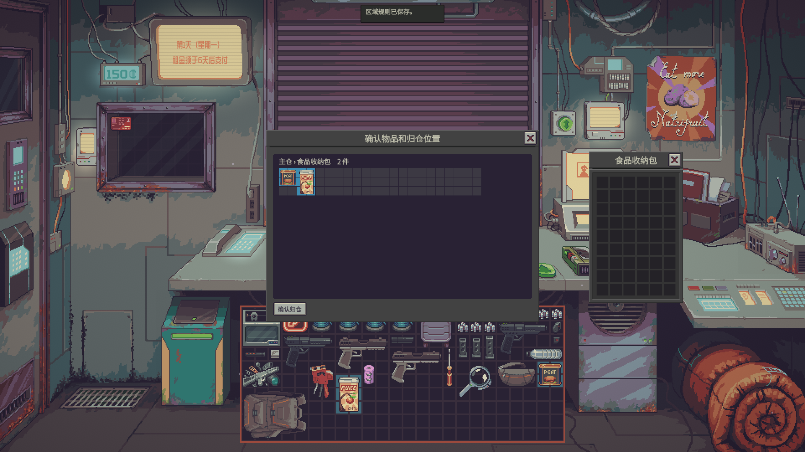
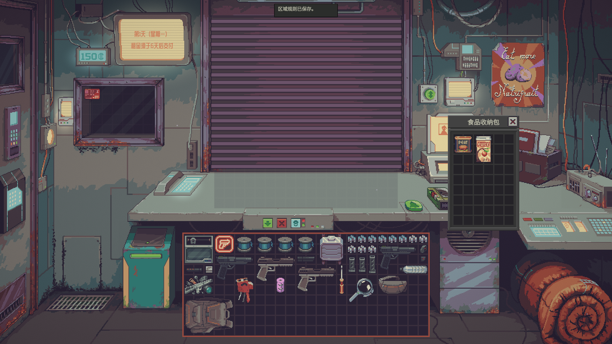
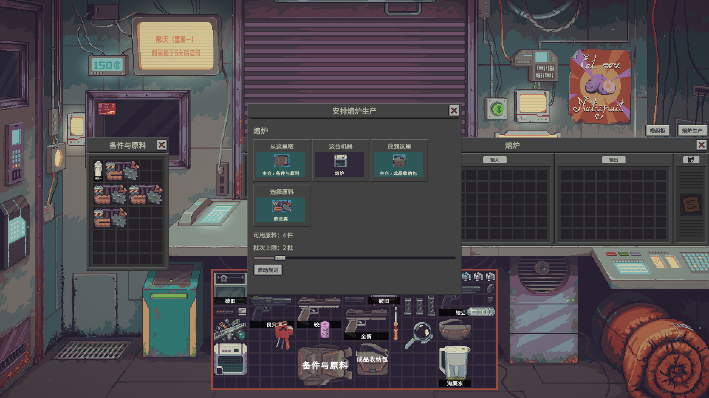
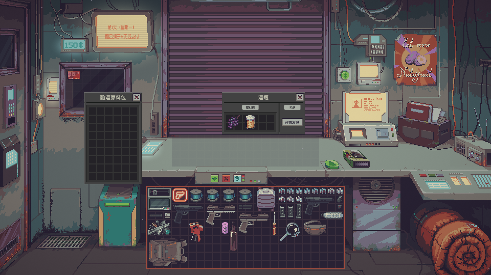
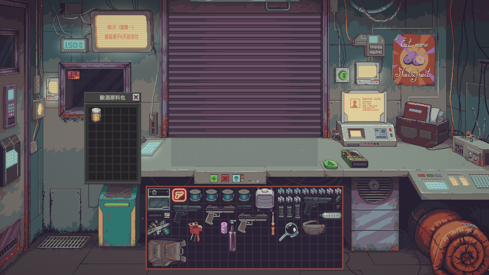

# 更好的体验 | Quality of Probably Stolen

店铺越开越大，找货、整理仓库和维护机器也会花掉更多时间。《更好的体验》提供一组可以按需开启的工具，帮你查看信息、减少重复操作，并按照自己设定的规则处理货物和机器。

**测试版说明：**本模组使用 GPT 制作，目前处于测试版，无法保证完全稳定。遇到问题建议到 [GitHub Issues](https://github.com/StarsWhere/Quality-of-Probably-Stolen/issues) 提交问题，并附上游戏版本、模组版本和复现步骤。

目前共有 **36 个主功能**，按对经营过程的影响分成三级。你可以只开启自己需要的功能。

| 级别 | 适合的用途 | 主功能初始状态 |
| --- | --- | --- |
| **一级：信息与手动操作** | 帮助查看信息、整理物品和操作原版界面；整理和移动仍由玩家发起。 | 19 项，其中 8 项默认开启 |
| **二级：规则与批量执行** | 玩家设置收发货和维护规则，模组执行重复搬运或处理。 | 11 项，默认关闭 |
| **三级：跨库存与机器管理** | 跨区域找货、比较组合和规划机器模组，适合希望减少逐项操作的玩家。 | 6 项，默认关闭 |

默认开启的八项是 **F02、F03、F04、F05、F38、F39、F40、F41**；其余主功能默认关闭。一级功能中的跨级子选项也单独关闭：F05 的自动腾位属于二级，F04 的额外读取隐藏风险属于三级。

文中的默认值适用于新配置或重置设置，已经保存的选择会保留。F 编号用于查找功能，**不是快捷键**。

## 安装与设置

在 Steam 创意工坊订阅并等待下载完成，在主菜单 **Mods → 更好的体验 / Quality of Probably Stolen** 中启用，按游戏提示重启。

手动安装时，把 ZIP 中完整的 `ShopAssist` 文件夹放入游戏目录的 `Mods` 文件夹，确保 `manifest.xml` 与 `ShopAssist.dll` 同级。

设置按 **一级、二级、三级 → 用途分组 → 主功能 → 子设置** 展示；可以用 F 编号、名称或用途查找。修改后点击 **应用**。离开时若有未应用的改动，游戏会要求选择继续编辑或放弃。

部分功能提供可自行绑定的快捷键，默认未绑定。自动搬运会遵循原版固定、锁定、物品归属和收货等限制；无法确认或需要检查的结果会保留在注意事项中。

例如，想按类别整理仓库，可以先用 F07 设置各储藏区的规则，再开启 F08 手动归仓；希望移动前检查去向时，再开启 F09。想预演机器模组布局，需要先开启 F10 模组柜，再开启 F12。

## 一级：信息与手动操作

### F02 显示容器和机器名称

**默认开启。** 在物品图案或合适的窗口标题显示储藏区和机器的名称，文字不会拦截鼠标。

默认只显示自定义名称，字号为 14（可调 6–24）；也可以开启未改名物品的默认名称、为文字加深色底板，或把名称移到上方，这三项默认关闭。

### F03 高亮顾客需要的物品

**默认开启。** 顾客购买或易货时，按原版需求标记匹配货物：普通需求为绿色，赃物为琥珀色，违禁品为红色；外层容器也会提示内部有匹配物品。

全收顾客默认不会让所有可出售物品铺满高亮，可以在设置中更改。另可开启顾客出售货物的赃物和违禁品风险标记，该选项默认关闭。

### F04 搜查时高亮已知风险

**默认开启。** 检查员到店时标出已知赃物、违禁品和曾经观察到风险的容器；赃物与违禁品可以分别开关，两项默认开启。

“搜查时额外读取隐藏风险”是独立的三级子选项，默认关闭。开启后还会检查可见物品及可打开的封闭普通容器，仍受上述风险类别开关控制。

### F05 右键智能整理

**默认开启。** 在店内普通仓储网格或物品上右键，选择智能整理：当前网格有框选时整理选中物品，否则整理整个网格。原版固定物品不会移动。

最近一次仍有效的整理可以撤销；之后物品或位置发生变化，可能使撤销失效。也可以自行绑定快捷键：优先整理鼠标所在的可操作容器，否则整理最近聚焦的可操作容器。

整理时允许旋转物品、鼠标移出后保持菜单均默认开启。“拖入放不下时自动腾位”是独立的二级子选项，默认关闭，需启用 F05 后使用。

### F14 拖动并停靠议价面板

**默认关闭。** 议价时可拖动面板标题栏，位置会保存在当前存档；也可以在设置中选择自动、左侧或右侧停靠。默认是自动，根据画面空间选择一侧。

面板内有关闭按钮，交易窗口标题栏提供重置位置的入口。

### F15 卷帘门八日历

**默认关闭。** 卷帘门放下后显示昨天、今天和未来六天，共八格，今天始终在第二格。悬停日期查看事件名称，点击日期查看当天详情，返回后继续看日历；开门时日历随门收起。

第一天的前一日只显示星期，没有事件详情；其他事件与详情来自原版公开日历。

已知问题：新存档中，日历下方的事件摘要可能显示错误日期；请以事件所在格和原版缴租提示为准。

### F16 成交回执

**默认关闭。** 成交后在顾客附近短暂显示现金收支和所属阵营的声望变化。两项默认都显示，也可以分别关闭；所选项目都没有变化时不会出现回执。

提示音默认关闭，音量默认 50%（0–100%）；回执默认停留 4 秒（1–12 秒）。

### F17 卷帘门待办

**默认关闭。** 关门时可以直接在卷帘门上勾选事项；营业时点击顾客计数屏上方的机壳打开便签，也可以自行绑定快捷键。

在便签或门上点击“+”新增事项，选择预设或输入内容，再选择一次性、每日、白天或夜间以及目标次数。每项可设 1–10 次，完成时逐次勾选；最多保存 64 项，每项 1–96 字。可以编辑、删除或清理已完成的一次性事项。昼夜切换时提醒未完成事项的选项默认关闭。

### F18 调整鉴定镜头

**默认关闭。** 鉴定时可以拖动镜头并记住位置，调整图像倍率、镜框和托盘的不透明度，或在鉴定界面重置视图。

图像倍率默认 100%（100–300%）；镜框和托盘不透明度各为 100%（0–100%）。隐藏放大镜外框默认关闭，开启后仍保留鉴定画面。

### F19 检测结果与处理方法

**默认关闭。** 水质或化学检测仪会显示各成分的体积和占比。点击成分可查看已核验的处理方法和参数，点击星标可将成分置顶；没有已核验方法时会明确显示。

占比条和按占比排序默认开启，色标默认关闭，也可以切回原顺序。字号默认 14（8–28）。

### F20 悬停查看容器内容

**默认关闭。** 在店内把鼠标停在可查看的普通容器上即可预览内容；锁定、隐藏或必须开封的内容仍需按原版方式查看。

悬停延迟默认 500 毫秒（100–2000 毫秒）；位置默认自动，也可选左侧或右侧。

### F21 卷帘门期限

**默认关闭。** 卷帘门底部显示房租或按揭的剩余天数。提前高亮默认为 1 天，可调 0–3 天；设为 0 时只在当天高亮，其他期限仍会显示。

### F23 鉴定工作单

**默认关闭。** 在原版鉴定视图中打开工作单，对机械手、肋排堡等已核验类型逐项选择观察结果，也可以打开对应的原版鉴定说明。观察项最初均为“未确认”，选择可以撤销；显示工作单的快捷键可自行绑定。

“计算鉴定工作单合计”是独立子选项，默认关闭。开启后，可根据已确认的观察项目计算能够判定的估价，并选择“采用估价”填入原版估价框；填入不会自动提交交易。燃料类型的公开说明与当前游戏计算规则不一致时不提供自动合计。

### F28 每日收支

**默认关闭。** 从电脑旁打开账本，按天和交易类型查看收入、支出、现金变化及已知成本毛利。可以翻日或输入日期，也可以按类型筛选。

开店前在卷帘门查看昨日摘要，开店后在墙面查看当日摘要；点击摘要可打开对应日期的明细。缺少进价记录的售货会单独标记，不从拆堆或合堆猜测成本。

### F38 显示公开标签

**默认开启。** 在可见物品旁显示原版提示中已经公开的标签，例如赝品或实验室纯级；悬停可查看完整内容，不读取隐藏标签。字号默认 9（6–16）。

### F39 已知赃物标记

**默认开启。** 为原版已揭示或玩家已经观察到的赃物显示常驻角标，并区分物品本身是赃物、容器内有已知赃物或两者皆是；不会探查未打开容器的未知内容。

角标默认位于左上角、使用实心样式，字号为 11（6–20）；位置、大小及实心或描边均可调整。

### F40 框选整组旋转

**默认开启。** 在店内框选同一网格中的多件可移动物品，拖动时依照游戏当前的旋转键及鼠标设置旋转整组。组内有堆叠物时，滚轮保留原版堆叠操作。

跨容器放置时，需要启用 F41 或按住 Shift，才能保留旋转后的相对位置。默认允许按住游戏框选键和 Alt，从已有物品的格子开始框选；可以在设置中关闭。

### F41 框选精确放置

**默认开启。** 将同一网格框选的物品拖到其他容器时，保留相对位置和不规则占格。绿色预览表示可以放下，红色表示碰撞或越界；固定或锁定的物品仍不能安全移动。

关闭 F41 后跨容器恢复自动摆放，按住 Shift 仍可精确放置。

### F42 快速播放

**默认关闭。** 开启后先绑定没有冲突的快捷键，可选择按住快进或按一下切换，默认按住快进；速度可选 2、4、8、16 倍，默认 8 倍，快捷键默认未绑定。

对话、电话、卷帘、角色进退场和转场等已支持的展示过程可以加快。遇到选择、确认、输入或菜单时暂停；切换场景或失去焦点后停止快进。未知内容保持原速，游戏时间和生产速度不会随之加快。

## 二级：规则与批量执行

### F01 普通收购留在后柜

**默认关闭。** 店内普通收购完成后，已付款且位于后柜的货物留在原位。易货、彩票、店外购买和原版自动入库仍按原版处理。

批发收购有独立开关，默认关闭，不依赖 F01 主开关。开启后结算前会检查后柜是否能容纳整批前台货物；空间不足时可以先腾位，或选择按原版批发结算。包含刮刮乐或彩票的批次按原版处理。

### F07 设置储藏区收货规则

**默认关闭。** 点击储藏区标题栏按钮，或右键网格打开收发货规则编辑器。

1. 选择要设置的储藏区；同一容器的不同页可以分别设置。
2. 选择公开品类，并按需要勾选“允许收货”和“允许自动出货”。
3. 保存规则；之后可以再次打开修改或删除。

规则供归仓和支持该规则的自动搬运使用。只有公开品类参与匹配，不需要为每件具体物品单独建规则。

### F08 按规则自动分类

**默认关闭。** 先为目标区域保存 F07 收货规则，再在当前网格右键归仓：有框选时处理选中物品，否则处理当前网格；也可以先选中物品，再使用自行绑定的快捷键。归仓由玩家手动发起，与 F05 智能整理独立。

货物按公开品类匹配允许收货的区域，可依次合入多个兼容的已有堆叠，剩余部分整堆放入空位；没有安全位置的部分留在原处。固定、锁定、无法确认或只能取出部分的源堆不会强行移动。后柜只处理交易结束且已付款、可以确认的货物。

关闭 F07 后，已保存的收货规则仍可用于选择目标，但不再限制来源区域的自动出货；需要编辑规则或按来源出货设置限制时，请开启 F07。

### F09 归仓前预览

**默认关闭，需要 F08。** 在设置中选择每次归仓都预览（默认）、仅有未移动物品时预览，或只预览而不移动。

预览按目标储藏区分组，列出物品、数量和合入已有堆叠的数量，也会列出未移动的物品及原因。确认前如果规则或库存变化，需要重新预览。

### F24 鉴定回单去向

**默认关闭。** 在设置中选择新生成鉴定回单的投递位置：前柜台、垃圾桶、展示柜或主仓，默认是前柜台。目标不可用时按原版方式投递；已有回单不会随设置改变而移动。

### F25 回店卸货模式

**默认关闭。** 在设置中选择“全部卸下”或“仅卸新增”，回店后自动处理可以确认的货物。优先送往匹配且允许收货的分类区，其次尝试主仓。

来源不明、混堆、收货受限或空间不足时，货物会保留，并在注意事项中等待检查；处理后可以重试，或确认已经自行处理。

### F31 自动更换低电量电池

**默认关闭。** 打开装有普通电池的自有设备，在窗口标题栏点击“备用电池”，选择装有普通电池的来源容器，再选择条件并保存。规则也可以复制到其他适用设备。若已开启 F07 并为来源设置规则，需允许自动出货。

条件可选保持最佳电量、保持最佳百分比或仅无法运行时更换。新电池须满足供电要求且严格优于当前电池，旧电池会安全放回来源。共享来源时先处理不足两次运行的设备，再按当前电量由低到高处理，电量相同时随机排序。

### F32 自动补种指定种子

**默认关闭。** 在水培机标题栏点击“自动补种”，选择本机产出或含种子的来源容器，再选择作物卡片。可以为单台机器停止规则。

非多年生作物收获后，功能会补入同植物、同基因且未堆叠的一粒种子；同种植物有多个品系时需先开启基因扫描。缺种、种子堆叠或设备未就绪时会等待，可以检查后重试或继续。

### F33 按批补料收货

**默认关闭。** 在熔炉标题栏打开“熔炉生产”，选择原料、来源、成品容器和 1–10 批后启动。每批使用两件独立的所选原料，生产后收走金属锭，达到批数后停止；也可以再生产一轮。

开始前需清空熔炉输入和输出，并移除冲突的输送器或熔炉模组。缺料、缺电、空间不足或机器状态不符时会暂停，处理原因后手动继续。

### F35 自动更换净水壶和养殖滤芯

**默认关闭。** 打开净水壶或养殖系统，点击“备用滤芯”，选择来源、滤芯材质与孔径要求，再选择“耗尽后更换”或“保持最佳剩余耐久”并保存。规则可以复制到其他适用设备。

孔径可限定同款、相同或更细，也可以允许任意孔径。只换入合适且耐久更高的滤芯，旧滤芯须能安全放回来源；共享来源优先处理耗尽的设备。

### F37 酿酒时归还活性酵母

**默认关闭。** 将活性酵母从店内普通物品格放入酒瓶时记录来源和方向；开始酿造时优先放回原位。原位不可用时，尝试主仓、柜台等已确认的空位。

没有空位时可以返回腾位，或选择按原版继续发酵；后者可能失去酵母。

## 三级：跨库存与机器管理

### F10 模组柜

**默认关闭。** 先打开自有、未锁定的机器窗口，再点击窗口中的“模组柜”，或使用自行绑定的快捷键。

可切换查看闲置模组、其他机器在用的模组和收纳区，按适用性筛选，并按性能、效率或品质降序排列。指定模组收纳区后，手动把模组拖入当前机器的模组舱，或从模组舱拖回收纳区。

### F11 跨库存找货

**默认关闭。** 在主仓窗口点击“找货”，或使用自行绑定的快捷键，按名称搜索可访问的自有库存。结果显示来源、数量以及固定或使用状态；单击结果可以定位。

能够安全整堆移动的结果可拖到空位，或拖到容量足够的兼容堆；不可取或只能取出部分时，请定位后手动处理。搜索和定位本身不会移动物品。

可选显示购入记录，默认关闭；该选项也用于预算配货。记录是原版当次购入总额，缺失时显示未知，不推算拆堆或合堆后的单位成本。

### F12 模组布局预演

**默认关闭，需要 F10。** 打开模组柜后，选择最多 5 个闲置且适用的模组；也可以不选新模组，只重排现有模组。点击“配装”，选择性能、效率或品质，再点击“预演”。

检查建议布局及三项属性变化后，可确认“应用布局”。已装模组会保留，可移动的已装件可能重新摆放；蒸发器只填空格。无法核实或不适用的组合不会预演。

### F30 机器供料、供电和产出

**默认关闭。** 在主仓窗口标题栏点击“机器状态”，或使用自行绑定的快捷键，查看水培机、集水器、蒸发器、打印机和熔炉等机器的供料、供电与产出状态，最多显示 100 条。

可以按区域筛选，或只看需要关注的机器；单击卡片查看位置并定位，双击打开机器窗口。

### F34 按报价挑选货物

**默认关闭。** 在议价面板标题栏点击“挑选货物”，勾选候选货物，使用已公开的顾客预算或填写预算上限，再比较组合。也可以排除赃物、违禁品、奢侈品，或只选已有公开需求标签的货物。

比较时会考虑真实柜台空间和报价；顾客拒收的台面货物仍占空间，但不计入报价。候选较多时搜索数量有限，可以缩小勾选范围再比较。

“允许将配货组合摆上交易台”是独立子开关，默认关闭。开启后可确认摆货；若货物、报价、预算或空间发生变化会停止，最终成交仍须手动确认。

### F36 自动最佳价值规划

**默认关闭。** 在垃圾场点击“拾荒装包”，或使用自行绑定的快捷键，即可根据公开物品信息规划并装入当前装备的背包和双手。结果会列出已处理和未搬走的物品及原因；限时搜索得到的是近似结果，不保证总价值最优。

背包预留空格默认 2 格（0–32 格），不影响双手；估值可选原版提示中的预估价值或基础价值，默认使用预估价值。替换已携带物品默认关闭，开启后才会在旧物能安全放回地面时尝试换入更有价值的物品。

内容可见且可安全核实的非空背包会作为整体参与规划，不会自动更换背包装备；无法核实的货物留在原处。替换中断时会尝试恢复并保留待处理记录；如果物品无法恢复，离开前会提示可能遗失，须明确确认。
